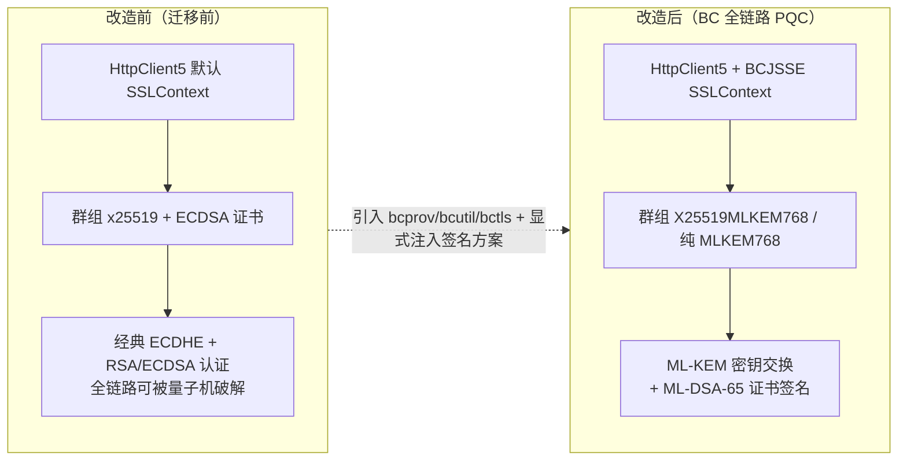
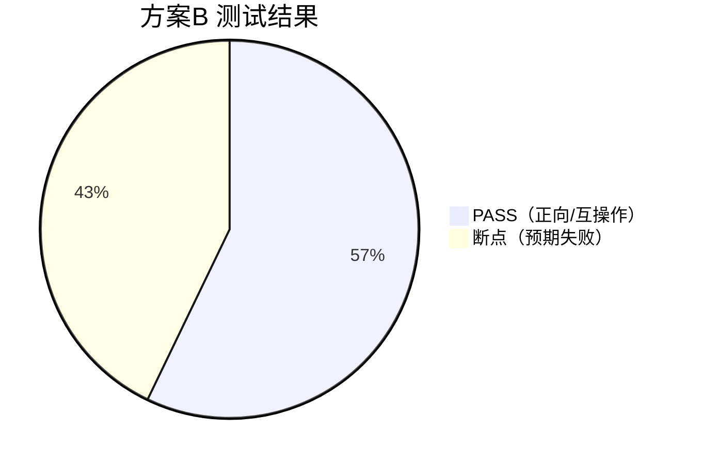

# 方案B 迁移测试报告 —— BouncyCastle BCJSSE 全链路 PQC（ML-DSA 证书 + ML-KEM 密钥交换）

## 1. 测试概述

| 项 | 内容 |
|---|---|
| 被测对象 | Apache HttpClient 5.6.4 + BouncyCastle BCJSSE（bctls-jdk18on 1.86） |
| 依赖 | `bcprov-jdk18on-1.86.jar`、`bcutil-jdk18on-1.86.jar`、`bctls-jdk18on-1.86.jar` |
| 环境 | JDK 27 (Oracle, build 27+35)，Windows |
| 目标 | 验证 BC 栈的**全链路 PQC**：PQC 证书签名（ML-DSA-65, FIPS 204）+ PQC 密钥交换（X25519MLKEM768 混合 / 纯 MLKEM768） |
| 结果 | **正向/互操作 4 项通过；断点 3 项按预期失败** |

## 2. 可视化：迁移前 → 迁移后



**结果概览**（PASS=4，断点=3，均为预期失败）



### BC 相对 JDK 的增量能力（实测确认）

| 能力 | JDK 27 | BCJSSE 1.86 |
|---|---|---|
| TLS 群组 `X25519MLKEM768`（混合） | ✅ | ✅ |
| TLS 群组纯 `MLKEM768/512/1024` | ❌ | ✅ |
| 证书签名 `ML-DSA-65`（TLS 认证） | ❌ | ✅（需显式注入签名方案） |
| SLH-DSA / Falcon 密钥生成 | ❌ | ✅ |
| `BCSSLParameters.setSignatureSchemes(["mldsa65",...])` | — | ✅（关键改造点） |

## 3. 迁移方案（方案B：BCJSSE 双栈，全链路量子抗性）

### 3.1 迁移步骤
1. 引入 `bcprov` + `bcutil` + `bctls` 三个 jar（bctls 依赖 bcutil，缺一即 `NoClassDefFoundError`）。
2. `Security.insertProviderAt(new BouncyCastleProvider(), 1)` 与 `new BouncyCastleJsseProvider(), 2`。
3. 用 BC `KeyPairGenerator` / `JcaX509v3CertificateBuilder` 生成 ML-DSA-65 证书与 PKCS12 密钥库。
4. 客户端/服务端均通过 `BCSSLParameters.setSignatureSchemes(["mldsa65","mldsa44","mldsa87",...])` 启用 PQC 签名方案。
5. 群组注入与 HttpClient5 接入方式同方案A，但走 BCJSSE 上下文。

## 4. 改造点（改造前 vs 改造后）

### 改造点 1：BC 提供者注册

**改造前**（无 BC 提供者，仅 JDK）

```java
// 迁移前：仅 JDK 提供者
// （无 BouncyCastleProvider / BouncyCastleJsseProvider）
```

**改造后**（注册 BC 与 BCJSSE，顺序敏感）

```java
// src/pqc/common/PqcSsl.java
public static void installBouncyCastle() {
    Security.removeProvider(BC_JCE);      // "BC"
    Security.removeProvider(BC_JSSE);     // "BCJSSE"
    Security.insertProviderAt(new BouncyCastleProvider(), 1);
    Security.insertProviderAt(new BouncyCastleJsseProvider(), 2);
}
```

**变化说明**：BCJSSE 必须插到 JDK 之前（位置1/2）以启用其 TLS 实现；同时带来"`SSLContext.getInstance("TLS")` 默认选中 BCJSSE"的副作用——JDK 上下文必须显式 `"SunJSSE"`（见方案A 改造点1）。

### 改造点 2：BCJSSE SSLContext（服务端/客户端）

**改造前**（JDK 上下文）

```java
SSLContext ctx = SSLContext.getInstance("TLS", "SunJSSE");
```

**改造后**（BCJSSE 上下文）

```java
// src/pqc/common/PqcSsl.java
public static SSLContext bcServerContext(KeyStore ks, String password) throws Exception {
    KeyManagerFactory kmf = KeyManagerFactory.getInstance("X.509", BC_JSSE);
    kmf.init(ks, password.toCharArray());
    SSLContext ctx = SSLContext.getInstance("TLS", BC_JSSE);
    ctx.init(kmf.getKeyManagers(), null, new SecureRandom());
    return ctx;
}

public static SSLContext bcClientContext(KeyStore trustStore) throws Exception {
    TrustManagerFactory tmf = TrustManagerFactory.getInstance("PKIX", BC_JSSE);
    tmf.init(trustStore);
    SSLContext ctx = SSLContext.getInstance("TLS", BC_JSSE);
    ctx.init(null, tmf.getTrustManagers(), new SecureRandom());
    return ctx;
}
```

**变化说明**：KeyManagerFactory 用 BCJSSE 的 `X.509`，TrustManagerFactory 用 BCJSSE 的 `PKIX`；否则无法加载/校验 ML-DSA 证书。

### 改造点 3：【关键】BCJSSE 逐连接注入 PQC 签名方案与群组

**改造前**（只设群组，不设签名方案）

```java
// 迁移前：BC 套接字只注入群组
BCSSLParameters params = bcSocket.getParameters();
params.setNamedGroups(new String[]{"X25519MLKEM768", "x25519"});
bcSocket.setParameters(params);
// 结果：ML-DSA 证书服务端握手报 "found no selectable cipher suite"
```

**改造后**（显式注入 mldsa 签名方案）

```java
// src/pqc/common/PqcSocketFactory.java —— BC 分支
if (bc && sslSocket instanceof BCSSLSocket bcSocket) {
    BCSSLParameters params = bcSocket.getParameters();
    params.setNamedGroups(namedGroups);                              // ["X25519MLKEM768","x25519"] 或 ["MLKEM768"]
    params.setProtocols(protocols);                                  // ["TLSv1.3"]
    params.setCipherSuites(sslSocket.getEnabledCipherSuites());      // 保留默认套件（否则套件被清空）
    params.setSignatureSchemes(PqcSsl.PQC_SIGNATURE_SCHEMES);        // ["mldsa65","mldsa44","mldsa87",...]
    bcSocket.setParameters(params);
}
```

**变化说明**：BCJSSE **不读全局 `jdk.tls.signatureSchemes`**，且默认签名方案不含 mldsa；必须逐连接 `setSignatureSchemes`，否则 PQC 证书握手直接失败。服务端每连接同样注入（`PqcHttpServer.handle` BC 分支）。

### 改造点 4：BC 原生生成 ML-DSA-65 证书

**改造前**（keytool 生成 RSA/EC 证书）

```bash
keytool -genkeypair -keyalg EC -groupname secp256r1 -dname "CN=legacy" ...
```

**改造后**（BC 生成 ML-DSA-65 自签名证书）

```java
// src/pqc/probe/GenBcMldsaKs.java（演示）
KeyPairGenerator kpg = KeyPairGenerator.getInstance("ML-DSA-65", "BC");
KeyPair kp = kpg.generateKeyPair();
X500Name subject = new X500Name("CN=pqc-bc-mldsa-server");
JcaX509v3CertificateBuilder b = new JcaX509v3CertificateBuilder(
        subject, BigInteger.valueOf(System.currentTimeMillis()),
        new Date(...), new Date(...), subject, kp.getPublic());
JcaContentSignerBuilder sb = new JcaContentSignerBuilder("ML-DSA-65").setProvider(new BouncyCastleProvider());
X509Certificate cert = new JcaX509CertificateConverter().setProvider(new BouncyCastleProvider())
        .getCertificate(b.build(sb.build(kp.getPrivate())));
```

**变化说明**：证书签名算法从 RSA/ECDSA 变为 **ML-DSA-65（FIPS 204）**，公钥/签名均为后量子算法。

### 改造点 5：HttpClient5 接入（同方案A，无差异）

```java
// 与方案A一致：SSLConnectionSocketFactory 注入 PqcSocketFactory
// 区别仅在 SSLContext 来自 bcClientContext() / bcServerContext()
```

## 5. 断点分析

### 5.1 【关键断点】BCJSSE 默认签名方案不含 ML-DSA
- **现象**：服务端加载 ML-DSA 证书、客户端**未**注入签名方案时：
  `TlsFatalAlert: handshake_failure(40); found no selectable cipher suite among the 3 offered`。
- **根因**：BCJSSE 的 `SignatureSchemeInfo` 虽含 `mldsa44/65/87`（反汇编确认），但默认 `isEnabled()=false`；ML-DSA 私钥无法签名 CertificateVerify → 服务端过滤掉全部 TLS1.3 套件。
- **修复**：双方显式 `setSignatureSchemes(PQC_SIGNATURE_SCHEMES)` 后握手成功（实测验证）。
- **结论**：**BC 的 PQC 证书能力必须显式开启**，不能只靠"引入依赖"。

### 5.2 【互操作断点】BC 客户端对 JDK 服务端不可显式设置签名方案
- **现象**：BC 客户端 `setSignatureSchemes([...])` 连接 JDK ECDSA 服务端 → 服务端 `No available authentication scheme`（`No X.509 cert selected for EC`）。
- **根因**：BC 显式注入的 signature_algorithms 使 JDK 服务端证书选择失败（`chooseServerAlias("EC")` 返回 null 的 JDK 服务端缺陷路径）。
- **修复**：BC 客户端对 JDK 服务端时**不设置签名方案**（走 BC 默认），实测互通正常（方案B 场景4 PASS）。
- **结论**：跨栈互操作时签名方案需按目标栈定制。

### 5.3 【断点】JDK 客户端无法认证 ML-DSA 证书（JDK 侧限制）
- **现象**：JDK 客户端（信任 ML-DSA 证书）连接 BC ML-DSA 服务端 → 服务端 `found no selectable cipher suite`（客户端未提供 mldsa 方案）。
- **结论**：**PQC 证书端到端链路要求两端都支持 ML-DSA 签名方案**；JDK 端需升级 BC 栈（方案B/C）才能消费 ML-DSA 证书。

### 5.4 【断点】JDK 无纯 ML-KEM 群组
- 客户端仅 `X25519MLKEM768` ↔ 服务端仅 `MLKEM768` → 无共同群组失败；JDK `SSLParameters.setNamedGroups(["MLKEM768"])` 也会在握手时抛 `IllegalArgumentException`。
- **结论**：纯 ML-KEM（非混合）是 BC 独有能力，适合**服务端已全面升级后的收敛阶段**。

### 5.5 顺带发现（工程层）
- BCJSSE `setSSLParameters` 会**清空默认密码套件** → 必须显式回填 `setCipherSuites(getEnabledCipherSuites())`。
- `bctls` 的 POM 依赖 `bcutil`（1.86 起 ASN.1 部分类移入 bcutil），只放 `bcprov`+`bctls` 会 `NoClassDefFoundError: org/bouncycastle/asn1/oiw/OIWObjectIdentifiers`。

## 6. 测试结果明细

| # | 场景 | 配置 | 结果 | 明细 |
|---|---|---|---|---|
| 1 | 正向：BC 全链路 PQC | ML-DSA-65 证书 + [X25519MLKEM768,x25519] | ✅ PASS | HTTP 200, 156ms, TLSv1.3 / TLS_CHACHA20_POLY1305_SHA256 |
| 2 | 正向：纯 ML-KEM-768 | ML-DSA-65 证书 + [MLKEM768] | ✅ PASS | HTTP 200, 12ms, TLSv1.3（JDK 无法做到） |
| 3 | 互操作：JDK 客户端 ↔ BC 服务端 | ECDSA 证书 + [X25519MLKEM768,x25519] | ✅ PASS | HTTP 200, 48ms |
| 4 | 互操作：BC 客户端 ↔ JDK 服务端 | ECDSA 证书 + 默认签名方案 | ✅ PASS | HTTP 200, 27ms |
| 5 | 断点：JDK 无纯 MLKEM | JDK[仅X25519MLKEM768] ↔ BC[仅MLKEM768] | ❌ 预期失败 | no selectable cipher suite |
| 6 | 断点：JDK 强制 MLKEM768 字符串 | JDK `setNamedGroups(["MLKEM768"])` | ❌ 预期失败 | IllegalArgumentException |
| 7 | 断点：JDK 客户端 ↔ BC ML-DSA 证书 | JDK 客户端 | ❌ 预期失败 | JDK 无法提供 mldsa 签名方案 |

服务端最终协商：`hybrid=TLSv1.3/TLS_CHACHA20_POLY1305_SHA256`、`pure=TLSv1.3/TLS_CHACHA20_POLY1305_SHA256`、`bcEcdsaHybrid=TLSv1.3/TLS_CHACHA20_POLY1305_SHA256`、`jdkEcdsaHybrid=TLSv1.3/TLS_AES_256_GCM_SHA384`。

## 7. 结论与上线建议

- 方案B 可实现**全链路后量子**：PQC 密钥交换（混合或纯 ML-KEM）+ PQC 证书签名（ML-DSA-65）。
- **代价**：引入第三方依赖（BC License，需法务确认）、需显式注入签名方案、需处理跨栈互操作细节。
- **建议路径**：先用方案A（纯 JDK）保护会话密钥；证书升级与收敛阶段再引入 BC 栈做 PQC 证书与纯 ML-KEM。
- 迁移期间**保留 `x25519` 与 ECDSA 证书**做兼容回退，仅在确认对端就绪后收紧。

---
*运行方式：`powershell -ExecutionPolicy Bypass -File run-all.ps1`；本报告数据对应 `logs/runB.log`。*
*可视化看板：`dashboard.html`*
