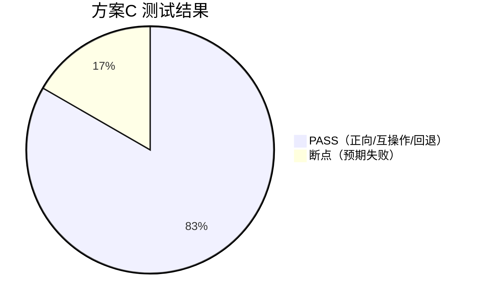

# 方案C 迁移测试报告 —— 混合式双栈（JDK 内置 + BouncyCastle，推荐生产方案）

## 1. 测试概述

| 项 | 内容 |
|---|---|
| 被测对象 | Apache HttpClient 5.6.4 + JDK JSSE + BouncyCastle BCJSSE 双栈并存 |
| 环境 | JDK 27 (Oracle, build 27+35)，Windows |
| 目标 | 验证生产推荐架构：PQC 优先、无缝回退、双栈互操作 |
| 结果 | **正向/互操作/回退 5 项通过；断点 1 项按预期失败** |

## 2. 可视化：迁移前 → 迁移后

```mermaid
flowchart LR
  subgraph 改造前["改造前（迁移前）"]
    C1[HttpClient5 单栈 JDK] --> S1[群组 x25519 + ECDSA 证书]
    S1 --> H1[经典 ECDHE<br/>可被量子机破解]
  end
  subgraph 改造后["改造后（混合式双栈，推荐）"]
    C2[HttpClient5 JDK+BC 双栈] --> S2[群组 X25519MLKEM768, x25519]
    S2 --> D{对端支持 PQC?}
    D -- 是 --> H2[ML-KEM 混合密钥交换<br/>量子抗性]
    D -- 否 --> H3[回退 x25519<br/>向后兼容]
  end
  改造前 -. 升级 JDK21+ / 引入 BC / 强制 TLS1.3 .-> 改造后
```

**结果概览**（PASS=5，断点=1，均为预期失败）



## 3. 迁移方案（方案C：分阶段收敛策略）

### 3.1 核心策略
```
客户端群组顺序： [X25519MLKEM768, x25519]
                 └─ 优先 PQC（混合式） ──┴─ 传统回退（兼容未迁移对端）
```
- **服务端先宽后严**：先同时启用混合群组与 `x25519`；对端全部就绪后再收敛为纯 `X25519MLKEM768` / `MLKEM768`。
- **证书先传统后 PQC**：互操作期用 ECDSA 证书；PQC 证书（ML-DSA）仅 BCJSSE 服务端可用，收敛期启用。
- **双栈共存**：JDK 栈负责日常，BC 栈负责 PQC 证书/纯 ML-KEM，通过 provider 顺序共存（JDK 上下文必须 pin `SunJSSE`）。

### 3.2 迁移阶段
| 阶段 | 动作 | 风险 |
|---|---|---|
| P1 | JDK 21+，TLS1.3 强制，群组 [X25519MLKEM768, x25519] | 低（x25519 兜底） |
| P2 | 服务端同时提供 PQC 群组 + x25519，证书仍 ECDSA | 低 |
| P3 | 引入 BC 栈，服务端启用 ML-DSA 证书（仅 BC） | 中（需显式签名方案） |
| P4 | 收敛：纯 X25519MLKEM768 / 纯 MLKEM768，全链路 PQC | 高（两端必须就绪） |

## 4. 改造点（改造前 vs 改造后）

> 方案C 复用方案A/B 的全部改造点，核心差异在于**双栈共存时的提供者管理**与**按目标选择签名方案**。

### 改造点 1：双栈注册 + JDK 上下文 provider 固定（共存关键）

**改造前**（单栈 JDK，无 BC）

```java
// 迁移前：仅 JDK，SSLContext.getInstance("TLS") 即 SunJSSE
SSLContext ctx = SSLContext.getInstance("TLS");
```

**改造后**（双栈共存，各自显式指定 provider）

```java
// src/pqc/common/PqcSsl.java
public static void installBouncyCastle() {
    Security.removeProvider(BC_JCE);
    Security.removeProvider(BC_JSSE);
    Security.insertProviderAt(new BouncyCastleProvider(), 1);    // 位置 1
    Security.insertProviderAt(new BouncyCastleJsseProvider(), 2);  // 位置 2
}
// JDK 上下文必须 pin：SSLContext.getInstance("TLS", "SunJSSE")
// BCJSSE 上下文：SSLContext.getInstance("TLS", "BCJSSE")
```

**变化说明**：注册 BC 后 `SSLContext.getInstance("TLS")` 默认命中 BCJSSE（位置2）。双栈共存时**每个上下文显式指定 provider**，否则 JDK/BC 栈会串线（实测踩坑）。

### 改造点 2：按目标栈选择签名方案（互操作细节）

**改造前**（统一/不区分签名方案）

```java
// 迁移前：不区分对端，一律默认签名方案
```

**改造后**（按对端栈定制）

```java
// src/pqc/common/PqcSsl.java
// 对 BC ML-DSA 服务端（需提供 mldsa 方案）：
public static final String[] PQC_SIGNATURE_SCHEMES = {
    "mldsa87", "mldsa65", "mldsa44",
    "ecdsa_secp256r1_sha256", "ed25519", "rsa_pss_rsae_sha256" };

// 对 JDK 服务端：BC 客户端【不设置】签名方案（用 BC 默认），实测互通
// （若显式设置会导致 JDK 服务端 "No X.509 cert selected for EC"）
```

**变化说明**：这是跨栈互操作的关键差异——同一套 BC 客户端代码，按目标服务端栈决定是否注入 mldsa 签名方案。

### 改造点 3：服务端群组注入（含回退）

**改造前**

```java
ss.setEnabledProtocols(new String[]{"TLSv1.3"});   // 仅版本，无群组
```

**改造后**

```java
// src/pqc/common/PqcHttpServer.java
SSLParameters params = ss.getSSLParameters();
params.setProtocols(new String[]{"TLSv1.3"});
params.setNamedGroups(namedGroups);                      // 传入 ["X25519MLKEM768","x25519"] 或 ["x25519"] 等
params.setCipherSuites(ss.getEnabledCipherSuites());     // 保留默认套件
ss.setSSLParameters(params);
```

**变化说明**：服务端群组可通过配置切换——互操作期 `["X25519MLKEM768","x25519"]`，收敛期 `["X25519MLKEM768"]` / `["MLKEM768"]`。

### 改造点 4：HttpClient5 客户端构建（PQC 优先 + 回退）

**改造前**（默认客户端）

```java
CloseableHttpClient client = HttpClients.custom().build();   // 默认 ECDHE
```

**改造后**（PQC 优先 + 回退）

```java
// src/pqc/approachC/MainC.java —— 生产客户端
PqcClient client = HttpClientFactory.build("方案C-生产客户端",
        jdkClientCtx,                                // JDK(SunJSSE) 或 BC 上下文
        new String[]{"X25519MLKEM768", "x25519"});   // PQC 优先，x25519 回退
```

**变化说明**：群组顺序决定了"优先 PQC、失败回退"的行为；这是方案C 兼容性与量子抗性的统一来源。

## 5. 断点分析

### 5.1 【断点】未启用 PQC 群组的传统客户端 ↔ PQC-only 服务端
- **现象**：客户端仅 `x25519`，服务端仅 `X25519MLKEM768` → `No common named group`（unexpected_message）。
- **结论**：**混合式迁移的正确姿势是"客户端 PQC 优先 + x25519 回退"，而不是只升级一端就强制收紧**。该断点正是"只迁移服务端、客户端未动"的失败形态，验证了方案C 策略的必要性。

### 5.2 【复用断点（详见方案A/B）】
| 断点 | 影响 | 详见 |
|---|---|---|
| JDK JSSE 无 mldsa TLS 签名方案 | PQC 证书依赖 BC 栈 | 方案A §5.1 / 方案B §5.3 |
| JDK 无纯 MLKEM 群组 | 纯 ML-KEM 仅 BC 收敛期可用 | 方案B §5.4 |
| BCJSSE 默认不含 mldsa 签名方案 | 必须显式注入 | 方案B §5.1 |
| BC 客户端对 JDK 服务端不能显式设置签名方案 | 跨栈互操作需定制 | 方案B §5.2 |
| `SSLContext.getInstance("TLS")` 在 BC 注册后优先 BCJSSE | 必须 pin provider | 方案A §4.1 |

## 6. 测试结果明细

| # | 场景 | 配置 | 结果 | 明细 |
|---|---|---|---|---|
| 1 | 互操作：JDK 客户端 ↔ BC 服务端 | [X25519MLKEM768,x25519] | ✅ PASS | HTTP 200, 179ms, TLSv1.3 |
| 2 | 互操作：BC 客户端 ↔ JDK 服务端 | BC 默认签名方案 | ✅ PASS | HTTP 200, 34ms, TLSv1.3 / TLS_AES_256_GCM_SHA384 |
| 3 | 回退：JDK 客户端 ↔ 传统服务器 | 客户端 PQC 优先，服务器仅 x25519 | ✅ PASS | HTTP 200, 65ms（自动回退 x25519） |
| 4 | 回退：BC 客户端 ↔ 传统服务器 | 同上 | ✅ PASS | HTTP 200, 66ms |
| 5 | 断点：未迁移客户端 ↔ PQC-only 服务器 | 客户端仅 x25519，服务器仅 X25519MLKEM768 | ❌ 预期失败 | No common named group |
| 6 | 正向：JDK ↔ JDK（生产默认） | [X25519MLKEM768,x25519] | ✅ PASS | HTTP 200, 37ms, TLSv1.3 |

服务端最终协商：`bc=TLSv1.3/TLS_CHACHA20_POLY1305_SHA256`、`jdk=TLSv1.3/TLS_AES_256_GCM_SHA384`、`legacy=TLSv1.3/TLS_AES_256_GCM_SHA384`、`pqcOnly=none`（断点场景）。

## 7. 结论与上线建议

- **方案C 是推荐生产路径**：双栈共存 + PQC 优先 + 传统回退，兼顾**量子抗性、兼容性、可回滚**。
- **关键纪律**：
  1. 群组顺序必须是 `[X25519MLKEM768, x25519]`，x25519 是兼容兜底，不可省略直到全量收敛；
  2. TLS 必须强制 1.3（PQC 群组不支持更低版本）；
  3. JDK 与 BC 上下文显式指定 provider，避免默认选择漂移；
  4. 跨栈签名方案按目标服务端定制。
- **后续收敛**：当全部对端支持 PQC 后，可逐步移除 `x25519` 与 ECDSA 证书，切换纯 ML-KEM + ML-DSA 全链路。

---
*运行方式：`powershell -ExecutionPolicy Bypass -File run-all.ps1`；本报告数据对应 `logs/runC.log`。*
*可视化看板：`dashboard.html`*
